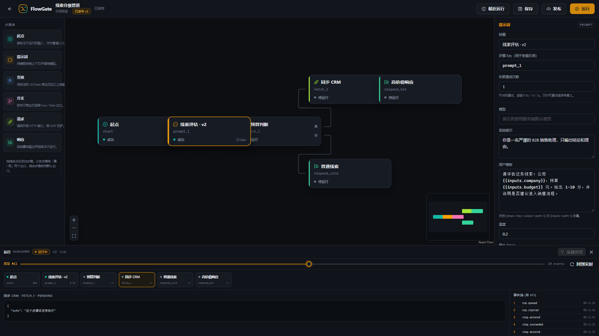

# FlowGate

> 可回放的 AI 管道编排台 · Event-sourced AI pipeline studio

[](showcase/assets/demo.mp4)

[在线展示页](https://nick456-jpg.github.io/flowgate/) · [GitHub 仓库](https://github.com/nick456-jpg/flowgate) · [2 分钟演示](showcase/assets/demo.mp4) · [展示页说明](showcase/README.md)

FlowGate 是一个从零实现的 AI 管道编排平台：把一条业务链路拆成带类型的步骤，在画布上编排，由后台 worker 执行，并让每一次运行都留下可回放、可恢复、可分支的事件日志。

## 为什么是 FlowGate

大部分工作流产品把「运行」存成一行状态字段，出问题只能看日志。FlowGate 把运行拆成 append-only 的 **Run / Step / Journal Event** 三层：

- **可回放**：拖动时间轴，按任意 `seq` 重建当时的节点状态、输出与分支选择。
- **可恢复**：worker 崩溃、运行被取消、服务重启后，从未完成的步骤继续。
- **可分叉**：从任意成功步骤 fork 出一条新运行，复用上游输出，只重跑分叉点之后。
- **可解释**：每一步输入/输出、LLM 用量、重试与跳过原因都在事件流里。

## v1 功能

- 认证：邮箱注册/登录、access token + 15 分钟、HttpOnly refresh cookie 轮换与复用检测。
- 工作区 → 项目 → 管道 → 修订：草稿乐观锁（`If-Match`）、不可变修订、head revision。
- 画布：React Flow 12、6 种步骤（起点 / 提示词 / 变换 / 分支 / 请求 / 响应）、descriptor 驱动配置表单。
- 运行：BullMQ 后台 worker、Postgres 租约 + 心跳、节点级重试、取消、崩溃恢复。
- 事件流：SSE 按 `seq` 续传、心跳保活、终态关闭；回放 / 恢复 / 分叉。
- 安全：Argon2id、刷新令牌轮换、AES-256-GCM 模型密钥、SSRF 防护、Prisma 参数化、Redis 滑动窗口限流（300/min/身份）。
- 演示：`LLM_MOCK=true` 时无需任何模型 Key 即可跑通；真实模型可用环境变量或工作区模型连接。

## 技术栈

| 层 | 选型 |
|---|---|
| 前端 | React 18、TypeScript、Vite 6、Zustand 5、Ant Design 5、React Flow 12、TanStack Query 5 |
| 后端 | NestJS 10、Prisma 6、PostgreSQL 16、Redis 7、BullMQ 5、Zod 3、JSONata |
| 契约 | `packages/flow-schema`：图 DSL、节点配置、事件、折叠函数、共享 DTO（CJS + ESM 双构建） |
| 部署 | Docker Compose（Postgres/Redis + API + Worker + Nginx Web） |

## 快速开始

前置：Node.js 20+、pnpm 10、Docker Desktop（或可用的 PostgreSQL 16 + Redis 7）。

```bash
cp .env.example .env
# 至少修改 JWT_SECRET（>=32 字符）与 ENCRYPTION_KEY（64 位 hex）
# 可用 openssl rand -hex 32 生成，两个值分别生成一次

pnpm install
pnpm infra:up        # Postgres :5433 / Redis :6380（避开常见默认端口）
pnpm db:migrate      # dotenv 读取根目录 .env
pnpm db:seed         # 演示用户、项目、管道、修订与一条可回放运行
pnpm dev             # API :3000 + Worker + Web :5173
```

打开 <http://localhost:5173>，使用演示账号：

```text
demo@flowgate.dev
flowgate-demo
```

演示数据是**非破坏性 seed**：已经存在的草稿、修订与运行不会被覆盖，可以放心重复执行。

### Docker 一键全栈

```bash
# 可选：先在 shell 中设置 JWT_SECRET / ENCRYPTION_KEY / LLM_*
pnpm infra:full
```

Web 在 <http://localhost:8080>，API 直连 <http://localhost:3001>。API 容器启动时执行 `prisma migrate deploy` + 幂等 seed，worker 随后消费运行队列。

> 若 Docker Desktop 的 Compose/Bake 报 `x-docker-expose-session-sharedkey ... non-printable ASCII characters`，可绕过 Compose Build，分别构建镜像后再启动：
>
> ```bash
> docker build -f infra/Dockerfile.api -t flowgate-api .
> docker build -f infra/Dockerfile.api -t flowgate-worker .
> docker build -f infra/Dockerfile.web -t flowgate-web .
> docker compose -f infra/docker-compose.yml --profile full up -d --no-build
> ```
>
> 构建需要能拉取 `node:22-bookworm-slim` 与 `nginx:1.27-alpine`；若 Docker Hub 不可达，请先配置镜像加速。当前开发环境已验证本地 dev 全链路，但 Docker 镜像构建因上述网络/Compose 环境限制未完成。

## 展示页与录屏

- 在线展示页：<https://nick456-jpg.github.io/flowgate/>（GitHub Pages）
- 本地展示页：`node showcase/server.mjs` → <http://localhost:4173>
- 2 分钟演示：`showcase/assets/demo.mp4`（1:55，1920×1080，静音，中文 VTT，8 个章节）
- 架构图：`showcase/assets/architecture.svg`；六张真实截图：`showcase/assets/login.png`、`workspace.png`、`editor.png`、`run.png`、`replay.png`、`fork.png`
- 展示页与录屏都来自本地实例与 `LLM_MOCK` 演示数据，不调用真实模型 API；展示页已在线发布，交互式应用需要本地运行，录屏就是完整演示。
- 详细说明与章节表见 [showcase/README.md](showcase/README.md)。

## 目录

```text
apps/api       NestJS HTTP + worker；Prisma；运行引擎
apps/web       React SPA；编辑器、运行带、回放
packages/flow-schema
               共享 Zod 图 DSL / 事件 / foldRun / DTO
infra          Dockerfile、Compose、Nginx
showcase       作品集展示页、架构图、六张截图与 2 分钟录屏
docs           ADR、架构、原创性说明、演示脚本
scripts        similarity-check.mjs
```

## 运行模型

```text
queued ──► running ──► succeeded
             │  ▲
             │  └── running ──► queued（租约过期的恢复）
             ├──► failed ──► queued（恢复）
             └──► cancelled ──► queued（恢复）
```

- 事件信封：`{ v, runId, seq, type, at, payload }`；`seq` 在同一个事务内分配。
- `run_events` 是真相；`run_steps` 只是列表/详情用的投影。
- Redis 只负责 BullMQ 调度、租约、限流与唤醒；SSE 永远从 Postgres 读事件。
- Fork：子运行记录 `parentRunId + parentSeq`，有效历史 = 父链事件（≤ 对应 fork 点）+ 子运行事件，不复制历史。
- 节点副作用按 **at-least-once** 处理；没有宣称 exactly-once。

更完整的设计与取舍见 [docs/architecture.md](docs/architecture.md) 和 ADR：

- [0001 模块化单体 + 独立 worker](docs/adr/0001-modular-monolith.md)
- [0002 事件溯源运行](docs/adr/0002-event-sourced-runs.md)
- [0003 JSONB 图 + 共享 Zod](docs/adr/0003-jsonb-graph.md)
- [0004 从 journal 读 SSE](docs/adr/0004-sse-from-journal.md)

## API 约定

- 基础路径 `/v1`，直接返回资源，不包 `{success, data}` 信封。
- 错误使用 `application/problem+json`（RFC 7807），校验错误带 `pointer`。
- 列表使用游标分页；草稿保存使用 `If-Match: <rowVersion>`；创建运行必须带 `Idempotency-Key`。
- SSE：`GET /v1/runs/:id/events?cursor=N`，`id:` = `seq`，终态关闭；`?format=json` 返回完整历史。

## 脚本

| 命令 | 说明 |
|---|---|
| `pnpm dev` | 同时启动 API、worker、Web |
| `pnpm build` | schema → API → Web 构建 |
| `pnpm typecheck` | 三个包类型检查 |
| `pnpm test` | schema 图/折叠测试 + API planner/URL 策略测试 |
| `pnpm db:migrate` / `db:deploy` / `db:seed` | 数据库迁移与演示数据 |
| `pnpm infra:up` / `infra:full` / `infra:down` | 本地依赖 / 全栈 / 停止 |
| `pnpm originality:check -- --reference <path> --target .` | 8-gram 源码相似度自检 |

## 与参考项目的关系

本项目与同类产品使用相同的产品方向与功能需求作为参考，原作者已授权参考。**没有复制**参考仓库的源码、迁移、UI 文案、素材或文档。领域模型（Pipeline / Revision / Run / Journal Event）、运行引擎（BullMQ + 事件日志 + fork lineage）、API 契约、数据结构和视觉语言均为独立实现。

`scripts/similarity-check.mjs` 的实测结果：**0 个完全相同的 TS/TSX 文件，平均 8-gram 重合度 0.85%**；单文件最高 38.1% 是标准的 `vite.config.ts` 样板，所有业务源文件均低于 5%。详见 [docs/originality.md](docs/originality.md)。

## v1 不包含

RAG / Embedding、Agent、MCP、API Key / 开放 API、模板市场、分享嵌入、定时/Webhook 触发、人工审批、多实例缓存失效广播、OpenAPI 生成、Playwright E2E。它们不影响 v1 的核心编排与回放闭环。

## 许可

当前仓库未附带许可证。公开发布或商用前请自行选择并补充 LICENSE；参考项目 `package.json` 标注 MIT，但本仓库未复用其代码，因此不自动继承其许可。
