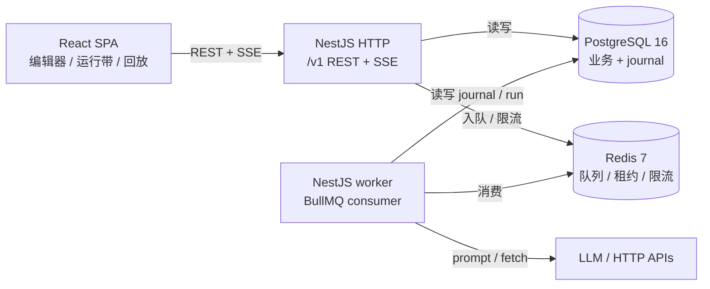
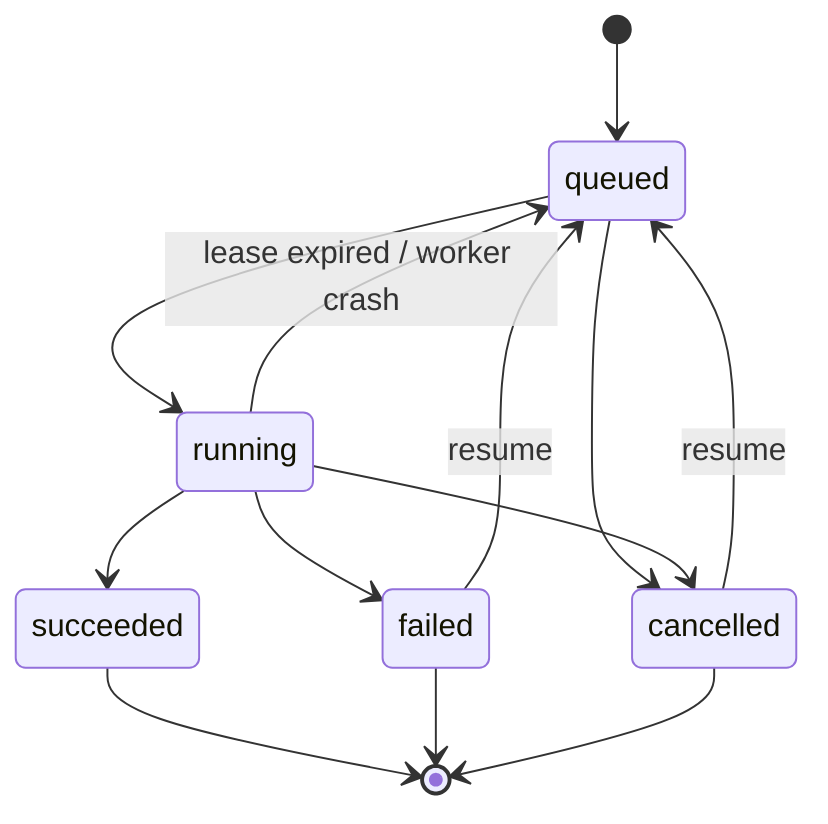

# FlowGate 架构

## 1. 系统上下文

Postgres 是唯一真相来源；Redis 只做调度与短期状态。API 和 worker 共用同一份 Nest 模块，但以不同的 `RUNTIME_ROLE` 启动，避免把 HTTP 控制器带进 worker 的执行循环。

## 2. 模块边界

| 模块 | 职责 | 依赖 |
|---|---|---|
| `platform` | 配置校验、Prisma、Redis、队列、AES-GCM、限流、健康检查 | 无 |
| `identity` | 注册/登录、JWT、refresh 轮换、全局鉴权与限流守卫 | platform |
| `workspace` | 工作区、成员角色、项目、模型连接、访问控制 | identity 类型、platform |
| `catalog` | 管道、草稿、不可变修订、图校验、版本号 | workspace、platform |
| `runtime` | run/journal、BullMQ 调度、执行器、SSE、恢复、fork | catalog 读接口、workspace、integrations |
| `integrations` | OpenAI 兼容 LLM 客户端、HTTP 客户端、SSRF 策略 | platform |

依赖方向单向：`platform ← identity ← workspace ← catalog ← runtime`；`integrations` 由 runtime 通过端口调用。没有 `forwardRef`。

## 3. 运行生命周期

执行器每次启动时：

1. 获取 Redis 租约 `run:lease:<id>`（`SET NX PX 20s`），每 5 秒续租，同时把租约写入 `runs`。
2. 展开有效历史（本运行 + 父链 fork 前缀），用共享 `foldRun()` 得到已成功步骤。
3. 按拓扑序执行。已成功步骤直接复用输出；分支未选中的边被关闭，下游标记 `skipped`。
4. 每个步骤带节点级重试（0.5s / 1s / 2s 退避），并同时检查 `cancelRequestedAt` 与 AbortSignal。
5. 所有步骤结束后，最后一个 `respond` 的输出成为 run output。
6. 每次状态变化都通过 `journal.record()` 追加事件；投影表 `run_steps` 与事件在同一事务更新。

崩溃恢复：worker 内的 sweeper 每 15 秒扫描 `status=running AND lease_expires_at < now()`，写 `run.recovered` 并把 run 重新入队。

## 4. 事件目录

| 事件 | 关键 payload |
|---|---|
| `run.queued` | `revisionId, trigger` |
| `run.started` / `run.resumed` | `workerId` |
| `run.recovered` | `previousLease` |
| `run.cancel_requested` | — |
| `run.succeeded` | `output` |
| `run.failed` | `error {name,message,code,status}` |
| `run.cancelled` | — |
| `step.entered` | `nodeKey, attempt` |
| `step.succeeded` | `nodeKey, attempt, output, durationMs` |
| `step.failed` | `nodeKey, attempt, error, durationMs` |
| `step.retry_scheduled` | `nodeKey, attempt, delayMs, error` |
| `step.skipped` | `nodeKey, reason` |
| `branch.selected` | `nodeKey, branch: true \| false` |
| `llm.usage` | `nodeKey, model, promptTokens, completionTokens` |

`seq` 在事务内通过 `UPDATE runs SET event_seq = event_seq + 1 RETURNING event_seq` 分配，`(runId, seq)` 唯一。前端只读事件，不依赖瞬时内存状态。

## 5. 数据模型

| 领域 | 表 |
|---|---|
| 身份 | `users`, `sessions` |
| 工作区 | `workspaces`, `workspace_members`, `projects` |
| 管道 | `pipelines`, `pipeline_drafts`, `revisions` |
| 运行 | `runs`, `run_steps`, `run_events` |
| 集成 | `llm_connections` |

- `pipeline_drafts` 用 `row_version` 做乐观并发；`revisions` 不可变，运行只绑定修订。
- 图存 JSONB，保存前用 `packages/flow-schema` 校验（唯一 key、DAG 无环、分支 handle、可达性等），并计算 canonical JSON 的 SHA-256。
- `run_events` 是 append-only journal；`run_steps` 是可丢弃、可重建的投影。
- `runs.eventSeq` 沿 fork 谱系单调递增，所以父事件（≤ `parentSeq`）与子事件可以拼成一个连续的 seq 序列。

## 6. Fork / resume / replay

- **Replay**：`foldRun(events, uptoSeq)` 是纯函数，前端用同一份实现重建任意时刻的步骤状态；实时与回放共用同一套节点渲染。
- **Resume**：复用同一 run id；API 把状态改回 `queued` 并追加 `run.queued`，执行器折叠已成功步骤，只重跑失败/未执行的步骤。
- **Fork**：选择父运行中某个 `step.entered` 事件，取 `parentSeq = seq - 1`；子运行自己的事件从 `parentSeq + 1` 开始。有效历史 = 父链（≤ fork 点）+ 子运行事件，不复制任何历史行。分叉点及其下游会重跑。

## 7. API 与 SSE

- REST：`/v1/auth`, `/v1/workspaces`, `/v1/projects`, `/v1/pipelines`, `/v1/runs`。
- 错误：RFC 7807 `application/problem+json`，校验错误带 JSON Pointer。
- 草稿：`PUT /pipelines/:id/draft` + `If-Match: rowVersion`，冲突返回 409。
- 运行：`POST /pipelines/:id/runs` 必须带 `Idempotency-Key`；同 key 同请求哈希返回同一个 run。
- SSE：`GET /runs/:id/events?cursor=N`，事件 `id:` 为 seq，支持 `Last-Event-ID`/cursor 断线续传；每 15 秒 keepalive；终态事件后关闭。SSE 只读 Postgres，不依赖进程内 Subject。

## 8. 安全与工程

- 密码 Argon2id；access JWT 15 分钟仅存内存；refresh token 为不透明随机串，数据库只存 SHA-256，轮换并检测 family 复用。
- 模型连接 API Key 使用 AES-256-GCM 加密存储，接口只返回元数据。
- `fetch` 节点仅允许 http/https，DNS 解析后阻断私网/回环/云元数据地址；10s 超时、1MB 上限、最多 3 次重定向。
- 不使用 `shell:true`、不使用 vm2；表达式用 JSONata，不执行任意 JS。
- 所有数据库访问经 Prisma；原生 SQL 使用参数化 `Prisma.sql`。
- Redis 滑动窗口限流（Lua ZSET），全局 300 次/分钟/身份。
- 迁移从第一天纳入版本控制；在全新 Postgres 上可重放 `prisma migrate deploy`。

## 9. 明确取舍

- 单实例假设：L1 缓存、取消 watcher 等仍是进程内状态；多实例需要 Redis Pub/Sub 广播或外置状态。
- at-least-once：`fetch` 等外部副作用不承诺 exactly-once，重试与恢复可能重复调用；事件日志暴露 attempt。
- JSONB 图：放弃服务端图查询，换取修订快照与校验的简单性。
- v1 不含 RAG / Agent / MCP；`knowledge` / `agent` 模块是预留的扩展缝。
